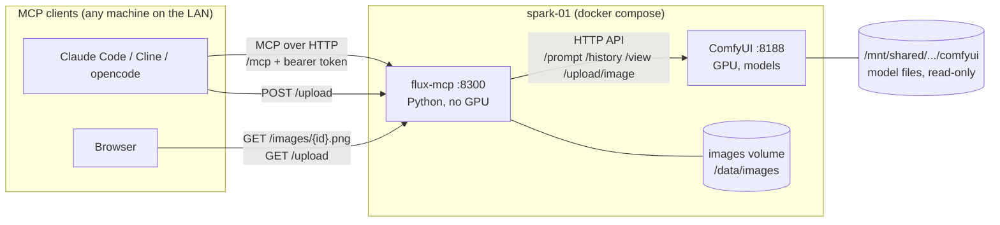
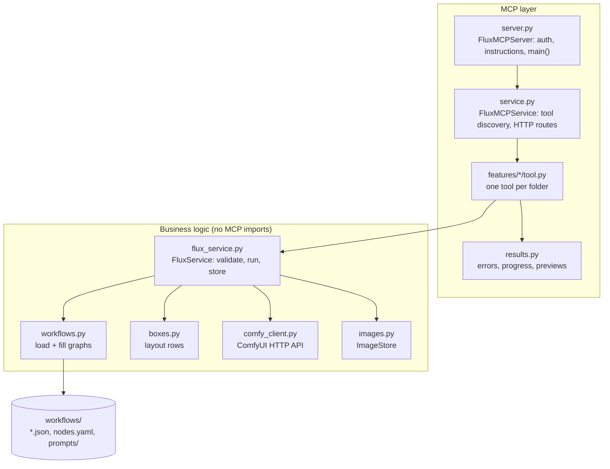
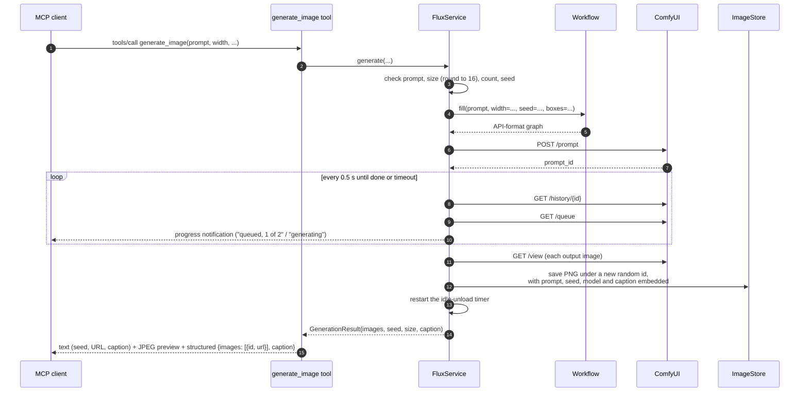
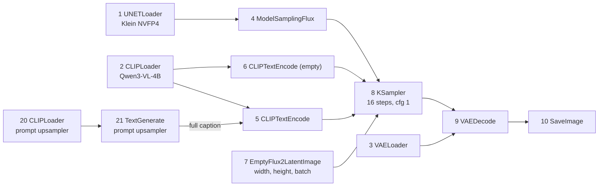
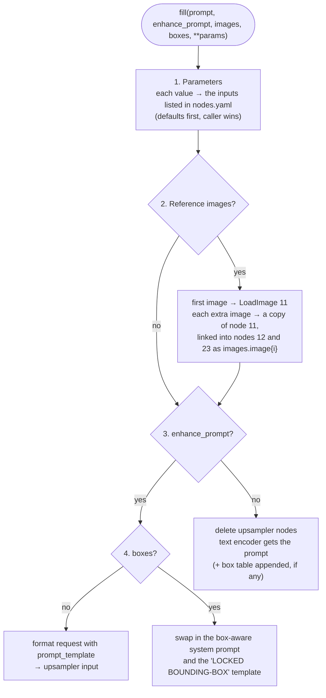
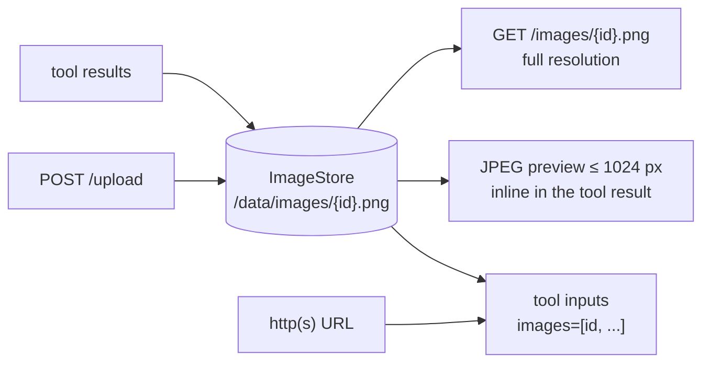
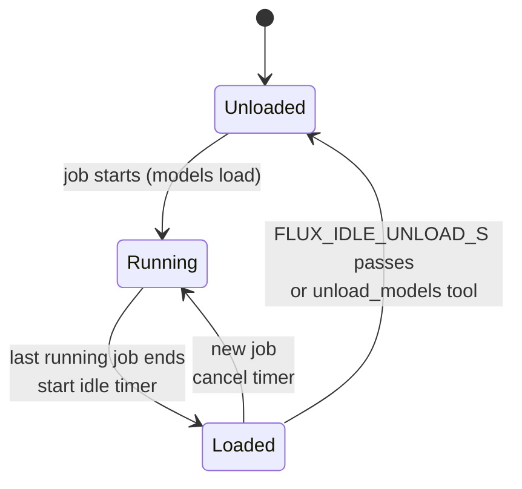
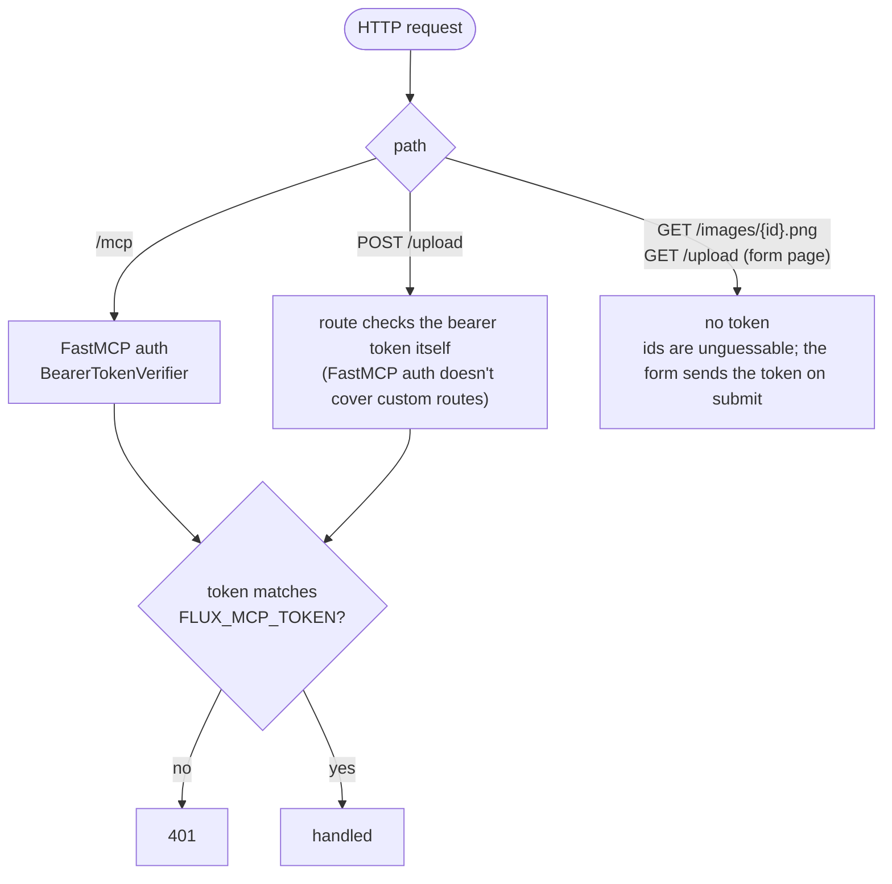
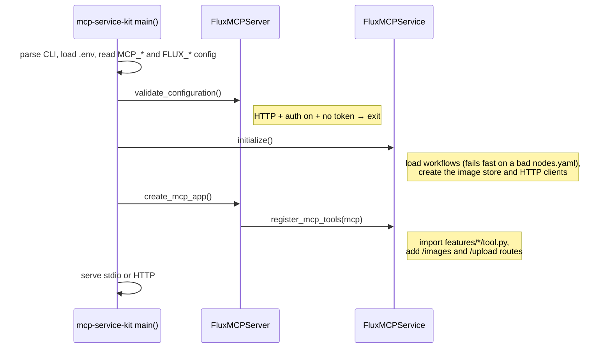

# Architecture

flux-mcp turns MCP tool calls into ComfyUI jobs. It owns no GPU code: it validates the request,
fills in a stored ComfyUI workflow, submits it, waits for the result, and hands back a preview and
a link. This page explains how the pieces fit together. For setup and usage, see the
[README](../README.md).

## The big picture

Two containers, one job each:

| Container | Does | Doesn't |
|---|---|---|
| **comfyui** | Loads models, runs workflow graphs on the GPU | Know about MCP, users or tokens |
| **flux-mcp** | Speaks MCP, checks input and auth, fills workflows, stores results | Load models or touch the GPU |

Because flux-mcp is a plain HTTP client of ComfyUI, either side can be restarted, upgraded or
moved independently.

## Code layers

flux-mcp is built on [mcp-service-kit](https://github.com/geosp/mcp-service-kit), which provides
the transports (stdio and streamable HTTP), the CLI and env-based config. The code is split so
that only the outer layer knows about MCP.

| Module | Responsibility |
|---|---|
| `server.py` | Server metadata, the instructions sent to client LLMs, bearer-token auth for `/mcp`, startup checks, `main()` |
| `service.py` | Builds everything at startup, registers every `features/*/tool.py`, serves `/images/<id>.png` and `/upload` |
| `features/*/tool.py` | Tool signatures and docstrings (what the client LLM sees). Thin: they call `FluxService` |
| `results.py` | Maps errors to MCP tool errors, forwards progress, builds the preview + URL result |
| `flux_service.py` | The real work: limits, seeds, sizes, loading input images, choosing a workflow, running it, storing outputs |
| `workflows.py` | Loads workflow JSON + `nodes.yaml` and fills in parameters (see below) |
| `comfy_client.py` | `submit`, `wait`, `fetch`, `upload`, `cancel`, `free` against ComfyUI's HTTP API |
| `images.py` | Saves PNGs under random ids, resolves ids, makes JPEG previews |
| `boxes.py` | Validates bounding boxes and turns them into the layout rows FLUX 3 expects |
| `auth.py` | Constant-time token comparison, shared by `/mcp` and `/upload` |
| `config.py` | `FLUX_*` settings (pydantic-settings) and the combined `AppConfig` |

## One tool call, end to end

What happens when a client calls `generate_image`:

Errors take the same path back. Bad input (`ValueError`), ComfyUI failures (`ComfyError`) and
timeouts become MCP tool errors with a readable message. On timeout the job is also removed
from ComfyUI's queue, or interrupted if it was already running.

Edits, upscaling and background removal add one step before submitting: each input image (an
id or a URL) is loaded and uploaded to ComfyUI with `POST /upload/image`.

## Workflows are data

Every capability is a ComfyUI graph in **API format** stored in `workflows/`. `nodes.yaml` says
which node inputs each parameter sets, so supporting a new model or tweaking a graph needs no
Python changes.

| Workflow | File | Used by |
|---|---|---|
| `t2i` / `t2i_hq` | `flux3_klein_t2i.json` | `generate_image` (`_hq` = Klein Base model, 50 steps, CFG 4) |
| `edit` / `edit_hq` | `flux3_klein_edit.json` | `edit_image` |
| `upscale` | `upscale.json` | `upscale_image` |
| `remove_background` | `remove_background.json` | `remove_background` |

The `_hq` entries reuse the same graphs; only their `defaults` differ.

### The text-to-image graph

The edit graph is the same, plus `11 LoadImage` → `12 ReferenceMultiLatent` (the reference
images) and `23 BatchImagesNode`, which lets the upsampler see the references.

### How a graph is filled

`Workflow.fill()` copies the template and changes it in four steps:

**The prompt upsampler.** FLUX 3 Klein expects full scene captions. Black Forest Labs ships a
Qwen3.5-9B upsampler that rewrites a short request into one. It runs inside the graph
(`TextGenerate`), so flux-mcp only formats its input. There are two flavours, each with its own
system prompt and request template from BFL's templates:

| Request | System prompt | Request template |
|---|---|---|
| plain | in the workflow JSON | `TARGET CANVAS: 3:2` + prompt (t2i); "Reference images follow in order…" (edit) |
| with boxes | `workflows/prompts/*_bbox.txt` | `ORIGINAL PROMPT: …` + `LOCKED BOUNDING-BOX ANNOTATIONS: [rows]` |

**Boxes** are `[y_min, x_min, y_max, x_max]` on a 0–1000 grid. `boxes.py` turns them into rows
`{"id": "obj_1", "bbox": [...], "desc": "..."}`, the same format ComfyUI's `Flux3LayoutPrompt`
produces.

## Images and ids

Every image flux-mcp knows about, whether generated, edited, upscaled or uploaded, lives in one
place and is addressed by a random 32-hex-character id.

- Ids are `uuid4().hex`, so URLs can't be guessed. They are the only protection on
  `/images/…` (see below).
- Each PNG records how it was made: a `flux-mcp` iTXt chunk holds JSON with the tool, prompt,
  seed, model, steps, inputs, boxes and the upsampled caption. The caption comes from a
  `PreviewAny` node (22) after the upsampler, whose text ComfyUI reports in `/history`.
  `get_image` reads the chunk back; without an id it returns the newest image.
- Everything is stored as PNG, so transparency from `remove_background` survives. Previews put
  transparent areas on white.
- Tool inputs accept an id, this server's own image URL, or any http(s) URL (downloaded,
  size-capped, checked to be an image).
- Images pasted into a chat can't reach a tool, because the model can't forward the bytes.
  That's why `/upload` exists.

## Model memory

ComfyUI keeps models loaded after a job, about 20 GB with everything resident. On spark-01 that
memory is shared with vLLM, so flux-mcp gives it back when nobody is generating:

Unloading is a `POST /free` with `unload_models` and `free_memory`; ComfyUI applies it once its
queue is idle. The timer only starts when no job is running, and each new job cancels it.
`server_status` reports the state and when the next unload will fire.

## Authentication

- One shared token, `FLUX_MCP_TOKEN`, compared in constant time (`auth.py`).
- HTTP refuses to start without a token unless `--no-auth` is passed. stdio needs no token.
- ComfyUI itself has no authentication. Keep port 8188 on a trusted network.

## Startup

mcp-service-kit's `create_main_with_modes()` drives startup. flux-mcp plugs in at three points:

## Extending it

| To… | Do this |
|---|---|
| Use a different model file (int8, bf16, …) | Change the loader node in the workflow JSON, or override `unet_name` in a `nodes.yaml` entry's `defaults` |
| Add a quality preset | A new `nodes.yaml` entry that merges an existing one (`<<: *t2i`) with other `defaults` |
| Add a workflow | Build it in the ComfyUI web UI → *Export (API)* → save in `workflows/` → map its inputs in `nodes.yaml` |
| Add a tool | New folder `features/<name>/` with a `tool.py` that defines `register_tool(mcp, flux)`; put the logic in `FluxService` |

`load_workflows()` checks every node id and input name in `nodes.yaml` against the graph at
startup, so a mapping typo stops the server instead of failing on the first request.

## Testing

Tests run without a GPU or a real ComfyUI. `tests/conftest.py` provides **FakeComfy**, which
answers ComfyUI's endpoints through `httpx.MockTransport`. It queues a job, reports it as
queued, then running, then done, and returns images of the size the graph asked for.

| Test file | Covers |
|---|---|
| `test_workflows.py` | Parameter mapping, reference cloning, upsampler on/off, quality presets |
| `test_boxes.py` | Box validation, layout rows, box-aware upsampler templates |
| `test_comfy_client.py` | Submit / poll / fetch, execution errors, timeouts and cancel |
| `test_flux_service.py` | Limits, sizes, input loading (ids, URLs, oversized, non-images), each tool's logic |
| `test_server.py` | Real MCP calls through an in-memory `fastmcp.Client`, `/images`, `/upload`, auth |

The real workflows are only proven against a running ComfyUI. After changing a graph, run one
call of each affected tool against the stack (the README has the steps).
